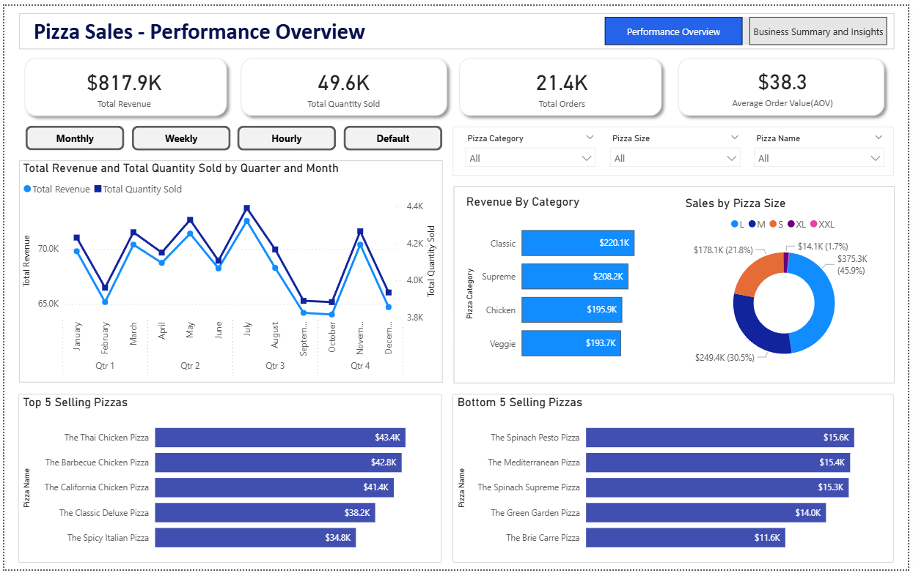
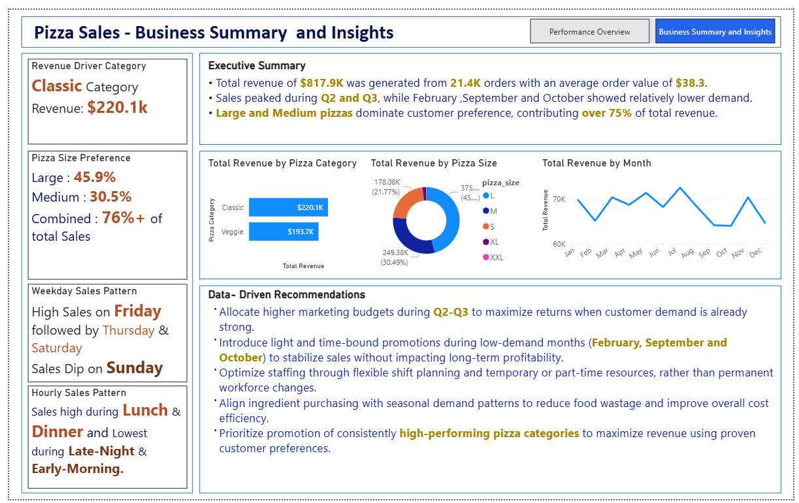

# 🍕 Pizza Sales Analysis Dashboard

An end-to-end data analytics project exploring pizza sales performance, product trends, ordering patterns, and business opportunities using **Power BI, DAX, and Power Query**.

## 📌 Project Overview

The Pizza Sales Analysis Dashboard transforms transactional sales data into meaningful business insights. It provides a structured view of revenue, order volume, product performance, and time-based sales patterns to help decision-makers understand what drives sales and where operational improvements may be possible.

This project demonstrates practical skills in data preparation, data modeling, analytical calculations, interactive visualization, and business-focused storytelling.

## 🎯 Business Objectives

- Evaluate overall sales performance using key performance indicators (KPIs).
- Identify the best- and worst-performing pizzas.
- Analyze daily, monthly, quarterly, and hourly sales patterns.
- Understand revenue contributions by pizza category and size.
- Identify peak ordering periods and potential opportunities for improvement.
- Translate analytical findings into practical, data-informed recommendations.

## 🛠️ Tools & Technologies

| Tool | Application |
|---|---|
| Power BI Desktop | Dashboard development and visualization |
| DAX | KPI measures and analytical calculations |
| Power Query (M) | Data transformation and preparation |
| Excel / CSV | Source data and data inspection |

## 📂 Dataset Overview

The project uses transactional pizza sales data containing order-level and product-level information.

**Key fields include:**

- Order ID
- Order Date
- Order Time
- Pizza Name
- Pizza Category
- Pizza Size
- Quantity
- Unit Price
- Total Price

The dataset contains approximately 48,620 transaction records covering January to December 2015. Each record represents a pizza product included in an order.

> **Data availability:** The complete raw dataset and Power BI report file are not included in this public repository. Selected documentation, dashboard screenshots, and project presentation materials are provided to demonstrate the analytical workflow and outcomes.

## 🔄 Data Preparation & Modeling

### 1. Data Loading and Validation
- Imported the source CSV data into Power BI.
- Verified data types for dates, times, text, and numeric fields.
- Checked for missing values and potential inconsistencies.
- Validated quantity and pricing fields.

### 2. Data Transformation
- Standardized pizza names, categories, and sizes where required.
- Prepared date and time fields for analysis.
- Checked the consistency of key analytical fields.

### 3. Feature Engineering
Derived additional time-based attributes to support the analysis:

- Order Day
- Month Name
- Month Number for chronological sorting
- Quarter
- Hour of Order

### 4. Analytical Modeling
Developed DAX calculations and analytical views to evaluate revenue, orders, pizza quantities, average order value, and product performance.

## 📊 Dashboard Features

### 1. KPI Summary
- Total Revenue
- Total Orders
- Total Pizzas Sold
- Average Order Value

### 2. Time-Based Analysis
- Monthly sales trends
- Quarterly revenue comparison
- Daily sales patterns
- Hourly sales distribution

### 3. Product Performance
- Top- and bottom-performing pizzas
- Revenue by pizza category
- Revenue by pizza size

### 4. Interactive Filtering
The dashboard includes slicers for:

- Month
- Day
- Hour
- Category
- Size

Custom slicer buttons support switching between monthly, weekly, and hourly views to make time-based analysis more accessible.

## 🖼️ Dashboard Preview

### Overall Dashboard

### Summary And Insight

## 🔍 Key Business Insights

The analysis identified several important patterns in pizza sales performance:

- **Overall performance:** The business generated approximately **$817.9K in revenue** from **21.4K orders**, with an average order value of **$38.3**.
- **Pizza size preference:** Large pizzas contributed approximately **45.9%** of revenue, while Medium pizzas contributed **30.5%**. Together, they accounted for over **76% of total revenue**.
- **Category performance:** The Classic category was the leading revenue contributor at approximately **$220.1K**, followed by Supreme at **$208.2K**.
- **Seasonal sales patterns:** Sales were relatively strong during parts of Q2 and Q3, while February, September, and October showed comparatively lower monthly revenue.
- **Ordering patterns:** Friday recorded the highest sales activity, while Sunday was comparatively weaker. Lunch and dinner were the strongest ordering periods.
- **Product performance:** The Thai Chicken Pizza was the highest revenue-generating pizza, while the Brie Carre Pizza was among the lowest-performing products by revenue.

## 💡 Business Recommendations

Based on the observed sales patterns, the following actions could be considered:

1. **Prioritize high-contribution products:** Review the performance of Large and Medium pizzas and ensure that popular products remain well represented in the menu.
2. **Plan targeted promotions:** Explore time-limited offers during comparatively weaker months and lower-demand ordering periods to encourage additional orders.
3. **Align inventory with demand:** Use category, size, and product-level sales trends to support ingredient purchasing and inventory planning.
4. **Explore average order value opportunities:** Test suitable combo offers, add-ons, and product pairings to encourage higher-value orders.
5. **Plan staffing around demand:** Consider stronger Friday, lunch, and dinner demand when reviewing staff schedules and shift allocation.

These are data-informed opportunities for further evaluation. Actual implementation should also consider profit margins, ingredient availability, staffing constraints, and operating costs.

## 📈 Project Outcomes

- Developed a structured view of key sales performance indicators.
- Improved visibility into product and time-based sales patterns.
- Translated analytical findings into practical business recommendations.
- Demonstrated an end-to-end analytics workflow from data preparation to business communication.

## 🚀 Future Enhancements

- Add cost and profit-margin analysis.
- Introduce customer segmentation, where suitable customer-level data is available.
- Forecast future sales using time-series methods.
- Explore automated data refresh and scheduled reporting.
- Incorporate inventory and product availability data for deeper operational analysis.

## 📁 Repository Contents

- `screenshots/` — Dashboard screenshots and visual previews.
- `data/` — Dataset overview and data dictionary.
- `documentation/` — Project presentation in PDF format.
- `README.md` — Project overview, methods, features, and business findings.

## 👤 About This Project

This project is part of my data analytics portfolio, demonstrating the use of Power BI, analytical thinking where applicable, data preparation, and business-oriented reporting.

**Focus areas:** Data Analytics · Power BI · DAX · Power Query · Data Visualization · Business Insights

